# The Corner Loaf: website redesign

A mobile-first rebuild of the website for The Corner Loaf, a neighbourhood bakery on Boundary Road, East Legon, Accra. Plain HTML, CSS and JavaScript. No framework, no backend.

```
index.html
css/styles.css
js/script.js
docs/sketch/The Corner Loaf sketch.drawio.svg
docs/screenshots/
README.md
```

## Visual assets

The design sketch is available at [The Corner Loaf sketch](docs/sketch/The%20Corner%20Loaf%20sketch.drawio.svg).

The key screenshots appear inline below. The full set is in [`docs/screenshots/`](docs/screenshots/):

- [320px first screen](docs/screenshots/320px-first-screen.png)
- [Desktop first screen](docs/screenshots/desktop-first-screen.png)
- [Desktop menu items](docs/screenshots/desktop-items-menu.png)
- [Desktop pre-order and About](docs/screenshots/desktop-pre-order-and-about.png)
- [Desktop About, hours, contact and footer](docs/screenshots/desktop-about-hours-contact-footer.png)
- [iPhone 16 first screen](docs/screenshots/iphone16-first-screen.png)
- [iPhone 16 navigation toggle open](docs/screenshots/iphone16-nav-toggle-on.png)
- [iPhone 16 days and menu items](docs/screenshots/iphone16-days-and-items-menu.png)
- [iPhone 16 pre-order and About](docs/screenshots/iphone16-pre-order-and-about.png)
- [iPhone 16 hours and contact](docs/screenshots/iphone16-hours-and-contact.png)
- [iPhone 16 original site](docs/screenshots/iphone16-original-site.png)
- [Menu item prices, right side](docs/screenshots/menu-item-prices-right-side.png)
- [Narrowed desktop window, top](docs/screenshots/narrowed-desktop-window-top.png)
- [Narrowed desktop window, bottom](docs/screenshots/narrowed-desktop-window-bottom.png)

---

## 1. Sketch and structure note

The [sketch](docs/sketch/The%20Corner%20Loaf%20sketch.drawio.svg) shows the phone layout from top to bottom.

**Why the page is ordered this way.** Marcus's regulars check the site on their phones while walking past. They are asking three questions, in this order: is it open, what is out today, and where is it. The page answers them in that order, on the first screen. Everything for people planning ahead (the weekly menu, pre-ordering, the FAQ) comes after, because those visitors are willing to scroll and walk-by customers are not.

- **Status and today's bakes are one block.** They answer one question, so they sit together at the top. When the shop is closed, the block says when it opens next and shows what is baking then.
- **Location comes straight after,** with a one-tap directions link for new visitors.
- **The hero banner is gone.** It used the most valuable space on the least useful content.
- **The weekly menu is organised by day,** not by item, because "what can I get on Tuesday?" is the question people ask.
- **About Marcus, then hours and contact, come last.** They give new visitors the small, real feel of the shop, but a regular does not need them to decide.

**What changed between the sketch and the build.** My sketch still had a pre-order form and a "Send us a message" form. I removed both in the build. The original forms never sent anything, and a form means typing on a phone, which is the biggest cost for someone mid-walk. Pre-ordering now happens on the item itself (see section 5), and contact is WhatsApp and email. I also dropped the separate description block, since the `h1` does that job.

---

## 2. Diagnosis of the original site

I checked the original at phone width and in a narrowed window. Each point gives the root cause and what it costs Marcus.

<p>
  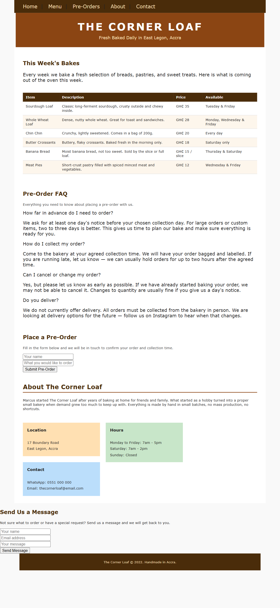
  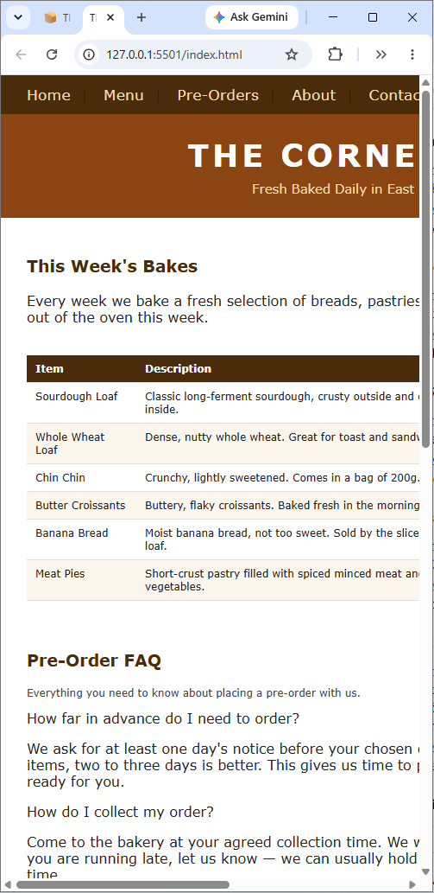
</p>

*Left: the original on an iPhone 16 view, shrunk to about 5px text. Right: the original in a narrow window, with the nav and hero cut off.*

**1. Today's availability is hidden in a table sorted by item.**
- *Root cause:* The table is organised the way Marcus thinks about his menu (item, then days). The visitor's question is the opposite (day, then items).
- *Impact:* Marcus loses walk-by customers when they have to read six rows and filter by today's day in their head. In a narrow window the Price and Available columns fall off the right edge entirely.

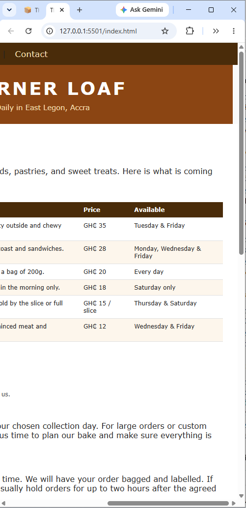

*The price and availability columns, the part walk-by visitors need most.*

**2. The page is not built for phones.**
- *Root cause:* There is no viewport meta tag. The header, hero, wrapper and footer are fixed at 820px, the info boxes are floats, and there are no media queries.
- *Impact:* On an iPhone 16 view the whole desktop layout shrinks to fit and the text is about 5px tall. Marcus loses the visitor who gives up instead of pinch-zooming.

**3. The order follows the template, not customer urgency.**
- *Root cause:* The sections run hero, menu, FAQ, form, about, contact, so the hours and address sit at the very bottom.
- *Impact:* A visitor cannot tell if the shop is open without scrolling the whole page, and the walk-by decision takes seconds.

**4. Both forms send nothing.**
- *Root cause:* The buttons are `type="button"` with no action, and `script.js` is empty. The fields have no labels.
- *Impact:* A customer can believe they have pre-ordered or messaged Marcus, but he never receives it. This is the most serious defect because it breaks trust.

**5. The markup has no structure.**
- *Root cause:* Everything is a `div`. The original navigation links all pointed to `#`, so clicking them did not navigate to a section or page. Headings jump levels, the FAQ questions are divs that a keyboard cannot reach, and the table header cells are `td`.
- *Impact:* Screen reader and keyboard users cannot navigate the page, and the original nav links did not work.

**6. There is no visual system, so it reads as a template.**
- *Root cause:* Font sizes mix `pt` and `px` across about nine values, styles are inline, and the info boxes use orange, green and blue pastels unrelated to the brown palette. Blocks use different widths and padding without `box-sizing: border-box`, so the footer is narrower than the wrapper and the contact section sits outside it.
- *Impact:* Marcus wants the site to feel like his warm, unfussy shop. A generic template does not.

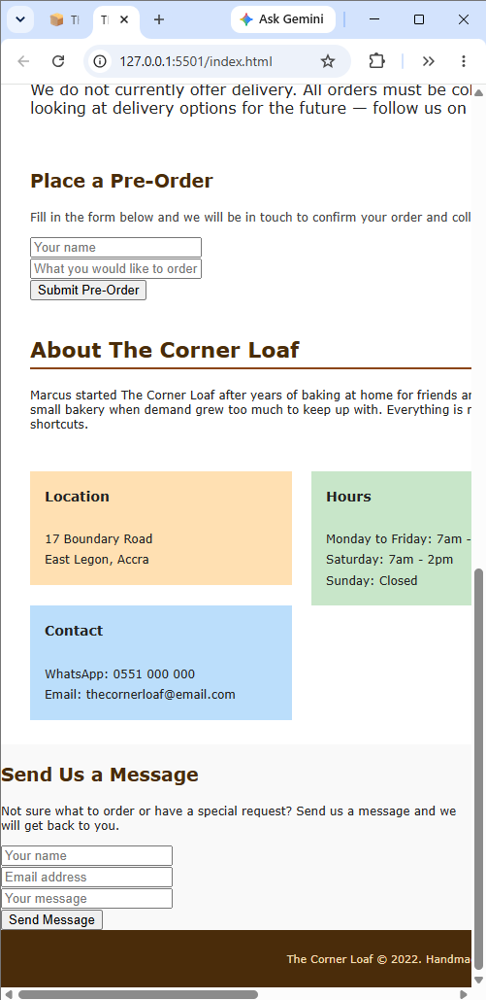

*The bottom of the original: hours and address only appear here (point 3), the forms are tiny and send nothing (point 4), and the info boxes and contact form break the layout (point 6).*

---

## 3. The rebuild: design decisions

**Palette.** A paper bag, oven and chalkboard scheme that keeps Marcus's browns and drops the template pastels.

| Token | Value | Used for |
|---|---|---|
| `--flour` | `#faf8f3` | Page background |
| `--ink` | `#2e1d12` | Text, chalkboard, footer |
| `--ink-soft` | `#6a5242` | Secondary text |
| `--kraft` | `#d8bd94` | Borders, header rule |
| `--kraft-tint` | `#f0e4d0` | Today panel, About band |
| `--crust` | `#7a3e12` | Buttons and links |
| `--wheat` | `#ebb94f` | Prices and headings on the chalkboard only |
| `--chalk` | `#f4ead8` | Text on the chalkboard |
| `--open` | `#2f6b3a` | The "open now" dot, always next to the word Open |

**Type.** Poppins at weights 400, 500 and 600, with system fallbacks. A 1.25 scale from 16px: 0.8, 1, 1.25 and 1.563rem, plus a fluid size for the `h1`. Everything is in `rem`.

**Spacing.** A 4px base: 0.25, 0.5, 0.75, 1, 1.5, 2, 3 and 4rem, used for every margin and padding. Tap targets are at least 44px.

**Live today panel.** A small script reads the weekly menu already in the HTML and shows the open or closed status plus the right day's items on the first screen. After closing it shows the next opening day's items. The menu is written once, so the panel can never disagree with it. Without JavaScript it falls back to a link to the weekly menu.

<p>
  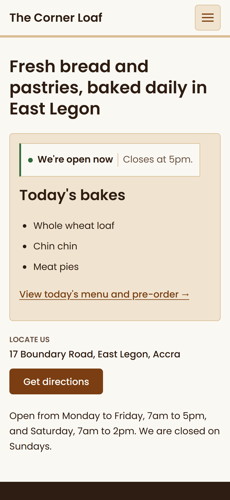
  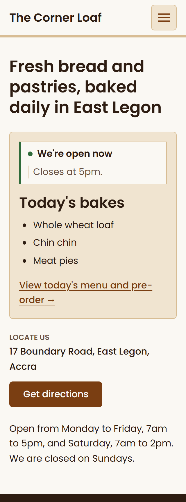
</p>

*The first screen on an iPhone 16 (left) and at 320px (right): status, today's bakes and location, with no scrolling.*

**The chalkboard menu.** The weekly menu is a dark board with dotted price leaders, like a bakery price board. It is the one bold choice on the page, and it makes the menu feel like the shop and not like a template.

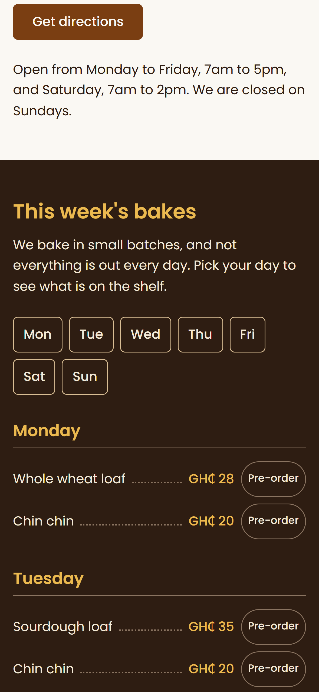

*The weekly menu on a phone, sorted by day, with a Pre-order button on each item.*

<details>
<summary>Desktop views</summary>

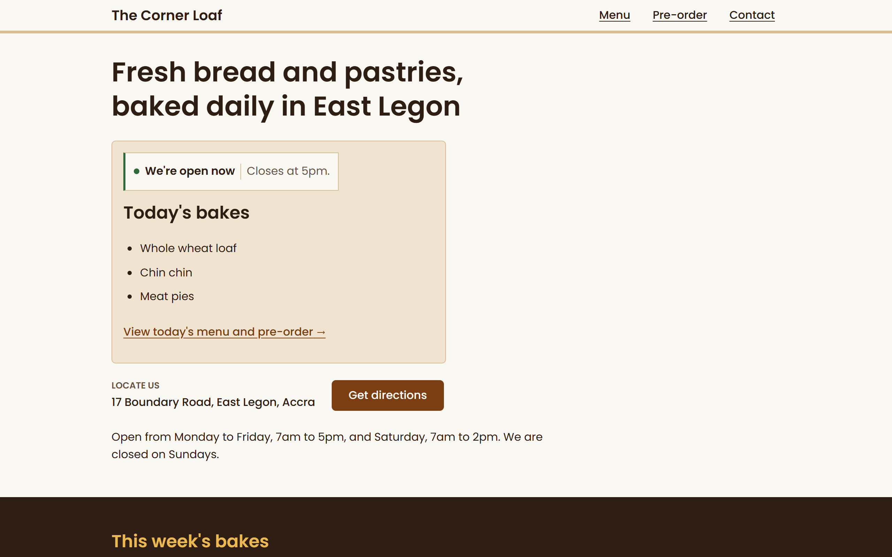

*Desktop first screen.*

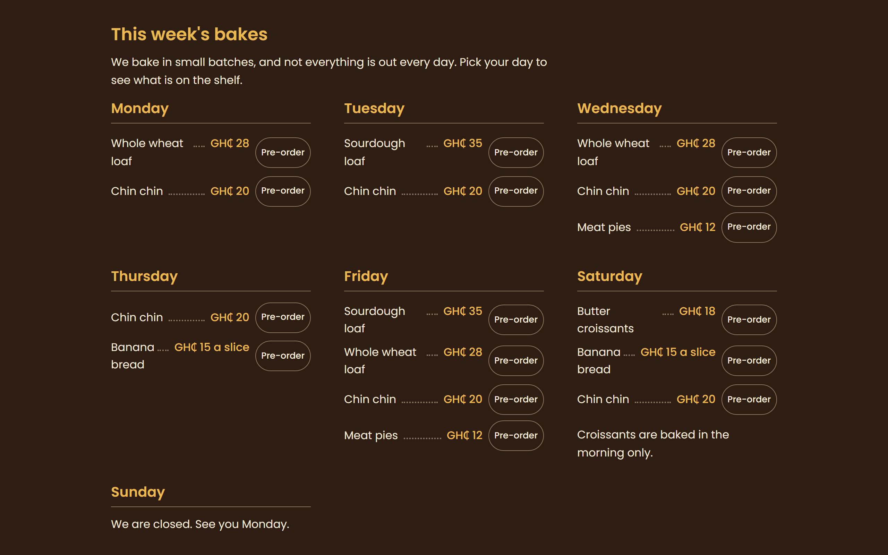

*Desktop weekly menu.*

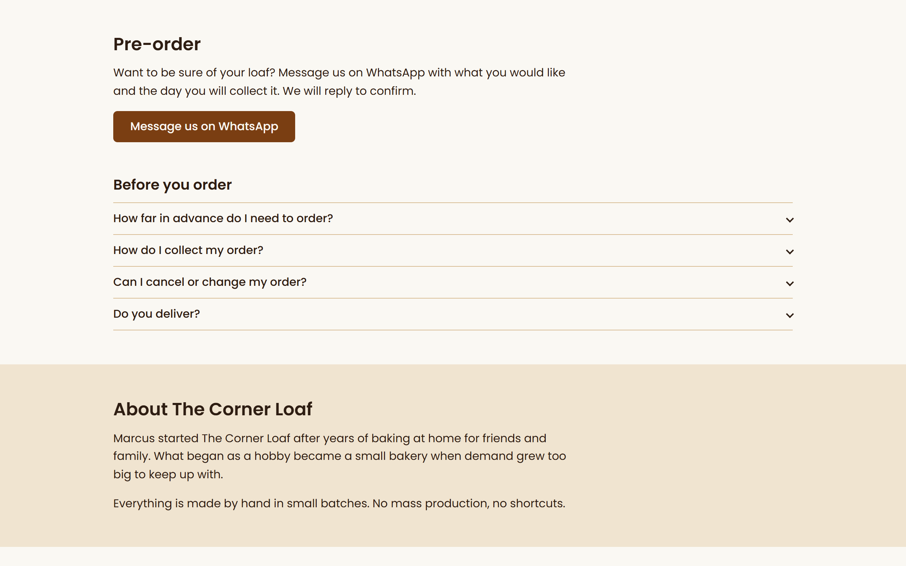

*Desktop pre-order and About.*

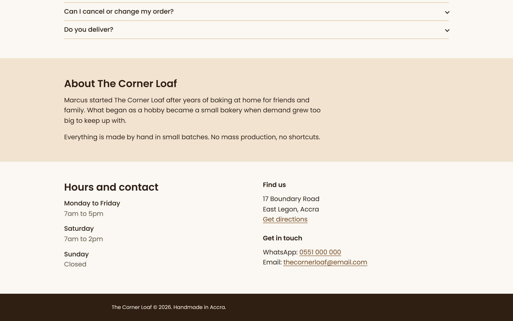

*Desktop About, hours, contact and footer.*

</details>

---

## 4. Audit of the finished page

**What I prioritised, and why.** Marcus's constraints are a phone, a walk-by visitor, a one-man bakery with no time to maintain a site, and no backend. So I put the first-screen answer first, then phone usability, then semantics and accessibility, then visual consistency. A technically perfect page that hid the day's bread would have failed the brief.

**Responsive**
- I checked the page at 320px, on an iPhone 16 view and on desktop (screenshots in section 3 and the full set above). At all three there is no sideways scrolling. The layout is mobile-first CSS that wraps by itself, with no fixed widths, which fixes the 820px layout that caused the original's problems.

**Semantic HTML**
- One `h1`, with `h2` for sections and `h3` for days. No skipped levels.
- Landmarks: `header`, `nav` (labelled), `main`, `footer`. Sections use `aria-labelledby`.
- Real elements for real jobs: `ul` for menu lists, `dl` for descriptions and hours, `address` for the location, and native `details` for the FAQ, which works by keyboard without JavaScript.
- Without JavaScript, the nav stays visible and the today panel falls back to a link.

**Baseline accessibility**
- Text contrast, calculated from the tokens, passes AA: ink on flour 15.2:1, secondary text on flour 6.8:1, links and buttons 7.8:1, chalk on ink 13.5:1, wheat on ink 8.9:1, crust on kraft-tint 6.6:1.
- Wheat is used only on the dark board. On flour it would be 1.7:1.
- The dotted leaders are 3.7:1, but they are decorative and hidden from screen readers.
- Status is never colour alone: the dot always sits next to the words "Open now" or "Closed now".
- Tap targets are at least 44px. Focus outlines are visible, and reduced motion is respected.
- A skip link at the top of the page lets keyboard users jump past the header and nav to the content.
- I tabbed through the whole page with the keyboard and could reach all of it.
- The 16 pre-order links each have a distinct accessible name, for example "Pre-order sourdough loaf for Tuesday on WhatsApp", and the visible text is part of that name.

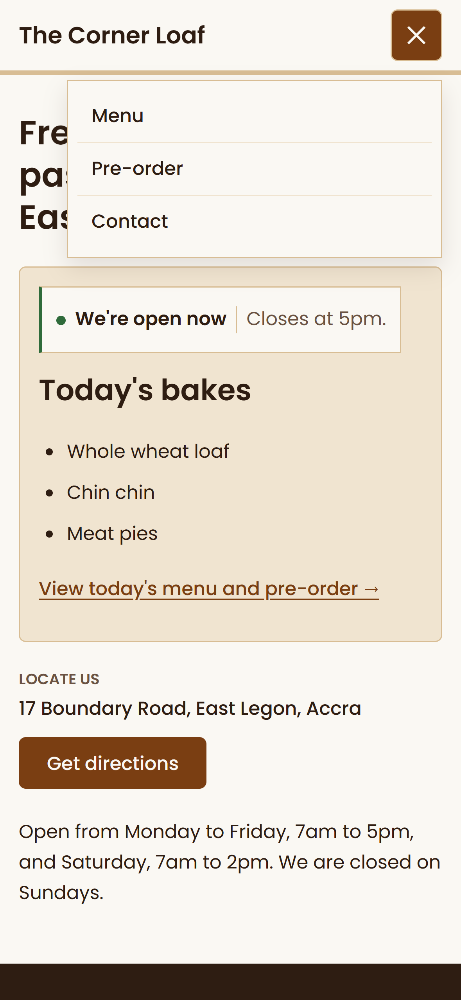

*The mobile navigation toggle open, with large tap targets.*

**Automated checks**
- Lighthouse (mobile, run through Live Server): Performance 98, Accessibility 100, Best Practices 100, SEO 100. axe DevTools (WCAG 2.1 AA) found 0 issues.

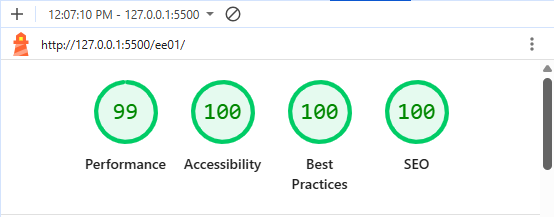

*Lighthouse tests results (mobile)*

- Two fixes came out of the Lighthouse run. A missing favicon caused a console error (Best Practices 96), so I added an inline icon. The today panel grew when the script filled it, which pushed the location down the page (layout shift 0.28 and Performance 85), so I now reserve space for the panel. A page that jumps while someone is looking for the hours is a real problem for a walk-by visitor, not just a score.

**Visual consistency**
- Every colour, type size and spacing value outside `:root` comes from the tokens. I found six hard-coded colours in the open/closed status box and replaced them with tokens, and the status states now differ only by the colour of the left edge and the words.
- The menu toggle radius now uses the 6px token. The one deliberate exception is the pill shape on the order buttons, which separates them from the main buttons.
- The FAQ answers use Poppins 400 italic, which is now loaded, so the browser no longer fakes the italic.

**Known gaps**
- The open or closed status comes from the weekly schedule. It cannot know if something has sold out, so it does not promise stock.
- Automated tools only catch part of the accessibility problems, and I have not tested with a screen reader. The contrast figures above are calculated from the tokens, and the tools found no contrast failures.

---

## 5. Additional improvement: one-tap pre-order from the item

**The gap.** The original pre-order form sent nothing, and it asked a phone user to retype the item they were already looking at. Marcus could lose orders without knowing.

**What I built.** Every item in the weekly menu, and in the today panel, has a Pre-order button. It opens WhatsApp with a message already written, for example "Hi Marcus, I'd like to pre-order a Sourdough loaf for Tuesday." The customer taps send. There is no form, no typing, and the order reaches Marcus on the app he already checks.

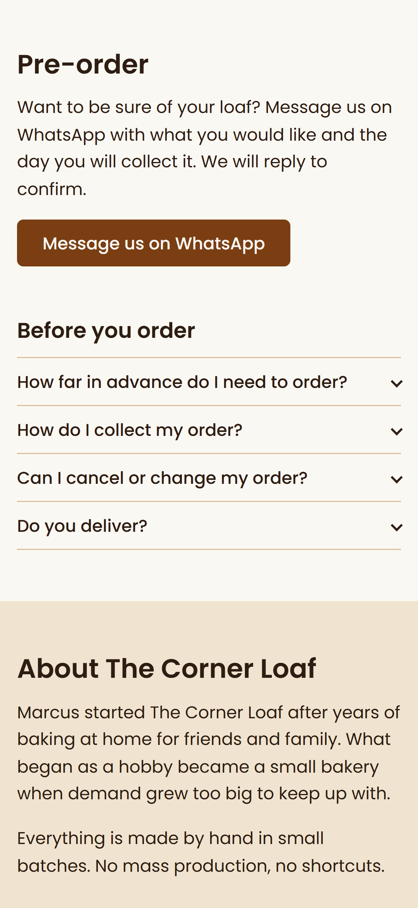

*The pre-order section on a phone, with the WhatsApp button and the FAQ.*

**Why it matters.**
- *For customers:* the person deciding what to buy turns that into an order in two taps, with the item and day already filled in.
- *For Marcus:* orders arrive in WhatsApp, where he already talks to customers, and they say which item and which day, so there is less back and forth. It also needs no server, nothing to maintain and nothing that can break.

**Limits I chose to accept.**
- One message per item, so a customer ordering three things sends three messages. That is acceptable for a bakery this size.
