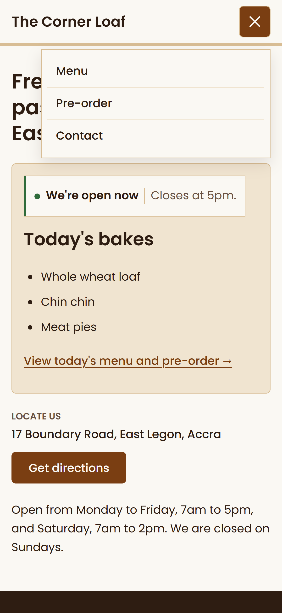
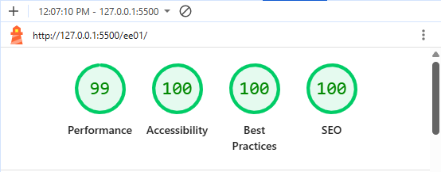

# Audit of the finished page

## Priorities

Marcus's constraints are a phone, a walk-by visitor, a one-man bakery with no time to maintain a site, and no backend. So I put the first-screen answer first, then phone usability, then semantics and accessibility, then visual consistency. A technically perfect page that hid the day's bread would have failed the brief.

## Responsive

- I checked the page at 320px, on an iPhone 16 view and on desktop (screenshots in [the design write-up](design.md) and the [screenshots folder](screenshots/)). At all three there is no sideways scrolling. The layout is mobile-first CSS that wraps by itself, with no fixed widths, which fixes the 820px layout that caused the original's problems.

## Semantic HTML

- One `h1`, with `h2` for sections and `h3` for days. No skipped levels.
- Landmarks: `header`, `nav` (labelled), `main`, `footer`. Sections use `aria-labelledby`.
- Real elements for real jobs: `ul` for menu lists, `dl` for descriptions and hours, `address` for the location, and native `details` for the FAQ, which works by keyboard without JavaScript.
- Without JavaScript, the nav stays visible and the today panel falls back to a link.

## Baseline accessibility

- Text contrast, calculated from the tokens, passes AA: ink on flour 15.2:1, secondary text on flour 6.8:1, links and buttons 7.8:1, chalk on ink 13.5:1, wheat on ink 8.9:1, crust on kraft-tint 6.6:1.
- Wheat is used only on the dark board. On flour it would be 1.7:1.
- The dotted leaders are 3.7:1, but they are decorative and hidden from screen readers.
- Status is never colour alone: the dot always sits next to words describing whether the bakery is open or closed.
- Tap targets are at least 44px. Focus outlines are visible, and reduced motion is respected.
- The skip link lets keyboard users bypass the header and go directly to the main content.
- The 16 weekly-menu pre-order links each have a distinct accessible name, for example "Pre-order sourdough loaf for Tuesday on WhatsApp", and the visible text is part of that name.

*The mobile navigation toggle open, with large tap targets.*

## Automated checks

- Lighthouse (mobile, run through Live Server): Performance 98, Accessibility 100, Best Practices 100, SEO 100. axe DevTools (WCAG 2.1 AA) found 0 issues.

*Lighthouse test results (mobile).*

- Two fixes came out of the Lighthouse run. A missing favicon caused a console error (Best Practices 96), so I added an inline icon. The today panel grew when the script filled it, which pushed the location down the page (layout shift 0.28 and Performance 85), so I reserved space for the panel. A page that jumps while someone is looking for the hours is a real problem for a walk-by visitor, not just a score.

## Visual consistency

- Every colour, type size and spacing value outside `:root` comes from the tokens. I found six hard-coded colours in the open/closed status box and replaced them with tokens, and the status states now differ only by the colour of the left edge and the words.
- The menu toggle radius now uses the 6px token. The one deliberate exception is the pill shape on the order buttons, which separates them from the main buttons.
- The FAQ answers use Poppins 400 italic, which is now loaded, so the browser no longer fakes the italic.

## Known gaps

- The open or closed status comes from the weekly schedule. It cannot know if something has sold out, so it does not promise stock.
- Automated tools only catch part of the accessibility problems, and I have not tested with a screen reader. The contrast figures above are calculated from the tokens, and the tools found no contrast failures.
