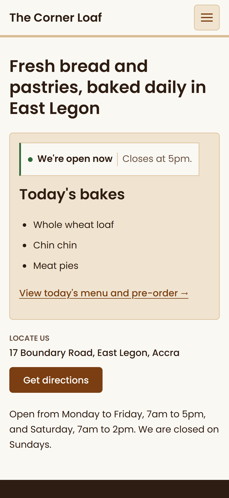
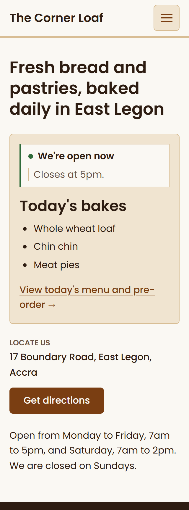
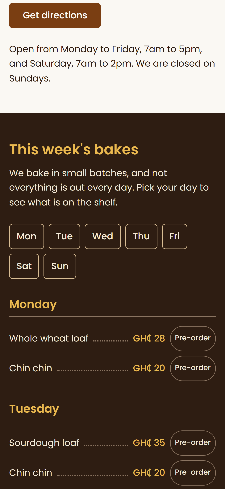
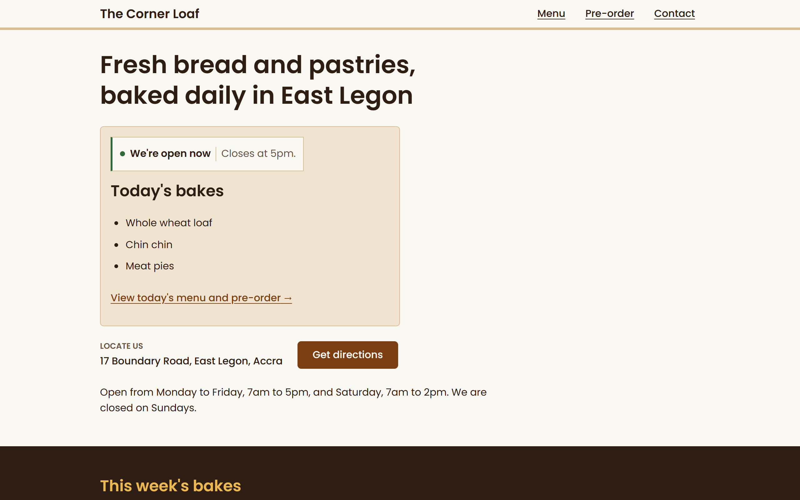
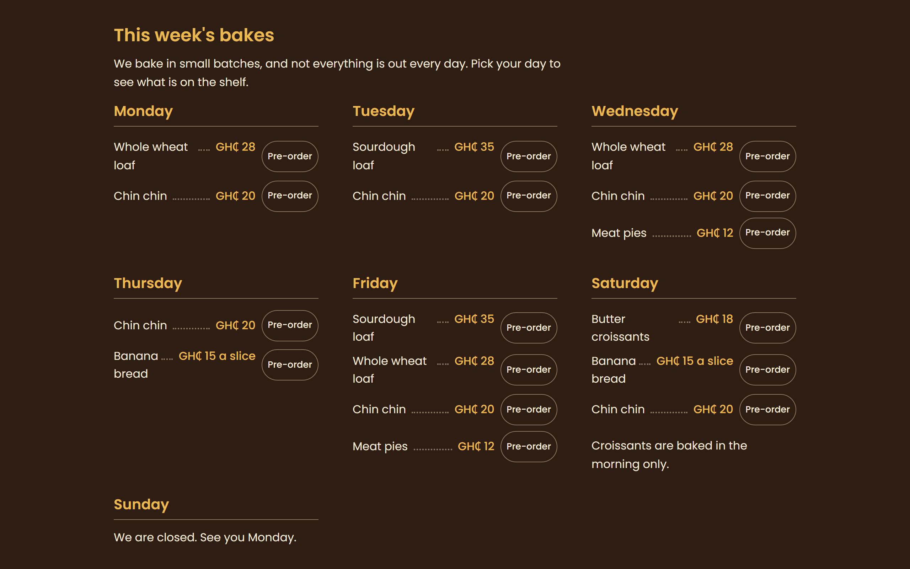
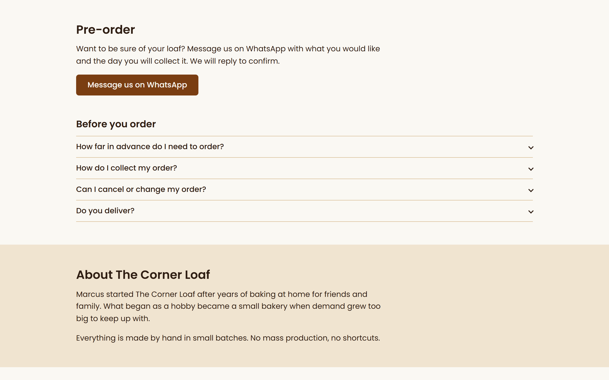
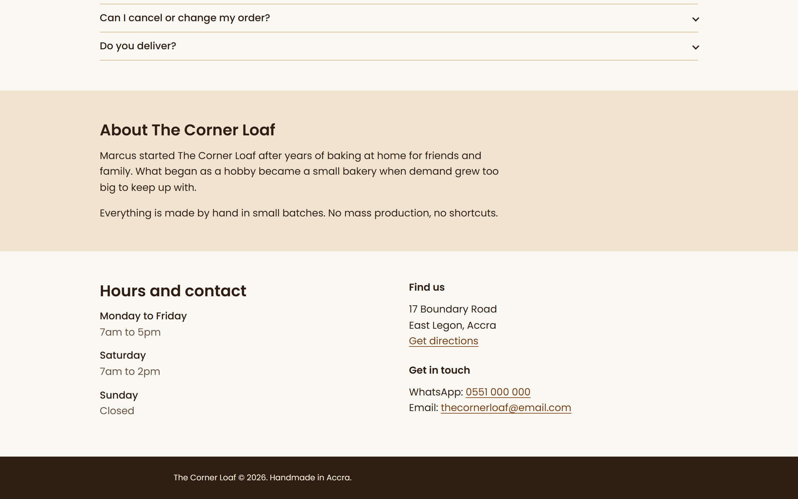

# Rebuild and design decisions

## Design system

**Palette.** A paper bag, oven and chalkboard scheme that keeps Marcus's browns and drops the template pastels.

| Token | Value | Used for |
|---|---|---|
| `--flour` | `#faf8f3` | Page background |
| `--ink` | `#2e1d12` | Text, chalkboard, footer |
| `--ink-soft` | `#6a5242` | Secondary text |
| `--kraft` | `#d8bd94` | Borders, header rule |
| `--kraft-tint` | `#f0e4d0` | Today panel, About band |
| `--crust` | `#7a3e12` | Buttons and links |
| `--wheat` | `#ebb94f` | Prices and headings on the chalkboard only |
| `--chalk` | `#f4ead8` | Text on the chalkboard |
| `--open` | `#2f6b3a` | The "open now" dot, always next to the word Open |

**Type.** Poppins at weights 400, 500 and 600, loaded from Google Fonts with system fallbacks. A 1.25 scale from 16px: 0.8, 1, 1.25 and 1.563rem, plus a fluid size for the `h1`. Everything is in `rem`.

**Spacing.** A 4px base: 0.25, 0.5, 0.75, 1, 1.5, 2, 3 and 4rem, used for every margin and padding. Primary navigation, menu and order controls are at least 44px; some inline links are smaller, as noted in the audit.

## Live today panel

A small script reads the weekly menu already in the HTML and shows the open or closed status plus a compact list of the relevant day's bakes on the first screen. After closing, it shows the next opening day's bakes. The weekly menu remains the source of truth. Without JavaScript, the panel falls back to a link to the weekly menu.

  
  

*The first screen on an iPhone 16 (left) and at 320px (right): status, today's bakes and location, with no scrolling.*

## The chalkboard menu

The weekly menu is a dark board with dotted price leaders, like a bakery price board. It is the one bold choice on the page, and it makes the menu feel like the shop and not like a template.

*The weekly menu on a phone, sorted by day, with a Pre-order button on each item.*

Desktop views

*Desktop first screen.*

*Desktop weekly menu.*

*Desktop pre-order and About.*

*Desktop About, hours, contact and footer.*

