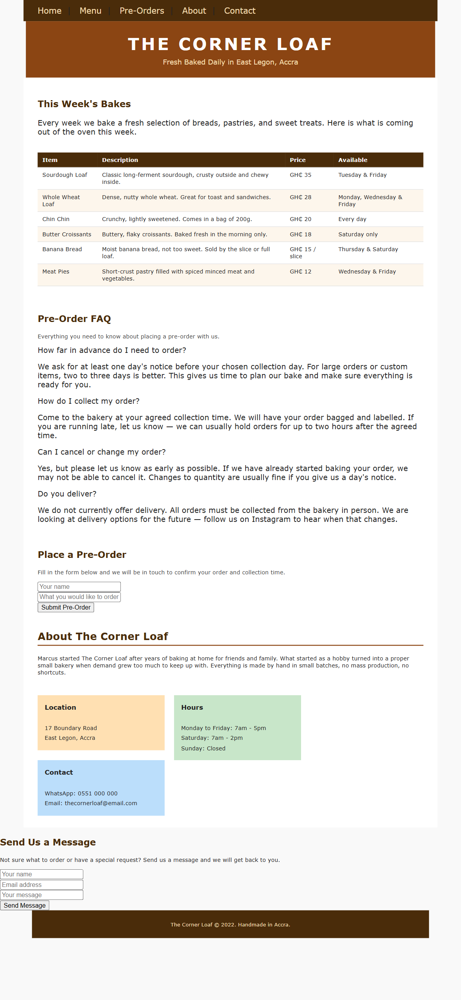
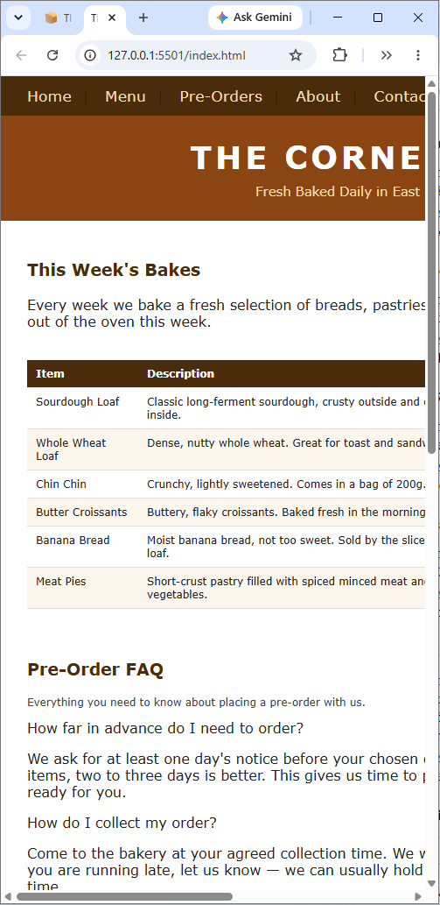
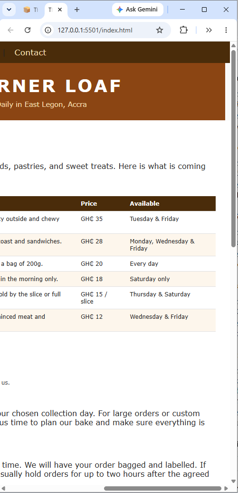
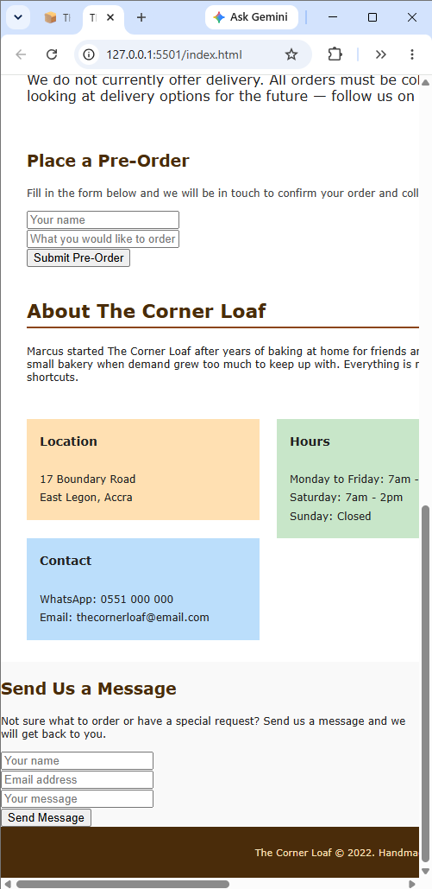

# Diagnosis of the original site

I checked the original at phone width and in a narrowed window. Each point gives the root cause and what it costs Marcus.

  
  

*Left: the original on an iPhone 16 view, shrunk to about 5px text. Right: the original in a narrow window, with the nav and hero cut off.*

**1. Today's availability is hidden in a table sorted by item.**
- *Root cause:* The table is organised the way Marcus thinks about his menu (item, then days). The visitor's question is the opposite (day, then items).
- *Impact:* Marcus loses walk-by customers when they have to read six rows and filter by today's day in their head. In a narrow window the Price and Available columns fall off the right edge entirely.

*The price and availability columns, the part walk-by visitors need most.*

**2. The page is not built for phones.**
- *Root cause:* There is no viewport meta tag. The header, hero, wrapper and footer are fixed at 820px, the info boxes are floats, and there are no media queries.
- *Impact:* On an iPhone 16 view the whole desktop layout shrinks to fit and the text is about 5px tall. Marcus loses the visitor who gives up instead of pinch-zooming.

**3. The order follows the template, not customer urgency.**
- *Root cause:* The sections run hero, menu, FAQ, form, about, contact, so the hours and address sit at the very bottom.
- *Impact:* A visitor cannot tell if the shop is open without scrolling the whole page, and the walk-by decision takes seconds.

**4. Both forms send nothing.**
- *Root cause:* The buttons are `type="button"` with no action, and `script.js` was empty. The fields have no labels.
- *Impact:* A customer can believe they have pre-ordered or messaged Marcus, but he never receives it. This is the most serious defect because it breaks trust.

**5. The markup has no structure.**
- *Root cause:* Everything is a `div`. The original navigation links all pointed to `#`, so clicking them did not navigate to a section or page. Headings jump levels, the FAQ questions are divs that a keyboard cannot reach, and the table header cells are `td`.
- *Impact:* Screen reader and keyboard users cannot navigate the page, and the original nav links did not work.

**6. There is no visual system, so it reads as a template.**
- *Root cause:* Font sizes mix `pt` and `px` across about nine values, styles are inline, and the info boxes use orange, green and blue pastels unrelated to the brown palette. Blocks use different widths and padding without `box-sizing: border-box`, so the footer is narrower than the wrapper and the contact section sits outside it.
- *Impact:* Marcus wants the site to feel like his warm, unfussy shop. A generic template does not.

*The bottom of the original: hours and address only appear here (point 3), the forms are tiny and send nothing (point 4), and the info boxes and contact form break the layout (point 6).*
