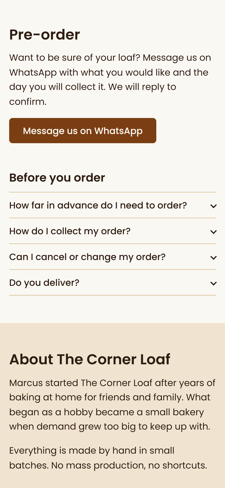

# Improvement: one-tap pre-order from the item

## The gap

The original pre-order form sent nothing, and it asked a phone user to retype the item they were already looking at. Marcus could lose orders without knowing.

## What I built

Every item in the weekly menu has a Pre-order button. It opens WhatsApp with a message already written, for example "Hi Marcus, I'd like to pre-order a Sourdough loaf for Tuesday." The today panel shows a compact list of that day's bakes and links directly to that day's menu, where customers can pre-order. There is no form, no typing, and the order reaches Marcus on the app he already checks.

*The pre-order section on a phone, with the WhatsApp button and the FAQ.*

## Why it matters

- *For customers:* the person deciding what to buy turns that into an order in two taps, with the item and day already filled in.
- *For Marcus:* orders arrive in WhatsApp, where he already talks to customers, and they say which item and which day, so there is less back and forth. It needs no custom server to maintain, though it depends on WhatsApp and the contact number staying current.

## Limits I chose to accept

- It needs WhatsApp. Email stays on the page as a fallback, but there is no SMS option.
- One message per item, so a customer ordering three things sends three messages. That is acceptable for a bakery this size.
