# EE02 write-up: fixes and further improvement

- **My site:** https://samuel-attu.github.io/the-corner-loaf/
- **Audit received from:** Joshua (`jandoh08`)

## Fixes

### Finding 1: Prices run into item names when someone enlarges text on a phone

- **Reproduced before fixing:** Yes. Setting Chrome's font size to *Very large* (`24px` root font size) at a `320px` viewport width caused longer two-word item names (such as *Sourdough loaf* and *Whole wheat loaf*) to overflow their container and overlap the price (`GH₵ 35`, `GH₵ 28`) on the same line.
- **Cause:** In `ee01/css/styles.css`, `.item-copy` (which holds the item name, dotted leader, and price) was a non-wrapping flex row (`display: flex` with no `flex-wrap`), and `.order-link` (*Pre-order*) used a tall `44px` button layout that consumed horizontal space on every menu row. At `320px` with *Very large* text, after subtracting `.order-link`, `.price` (`white-space: nowrap`), and `.dots`, the remaining space for `.name` was narrower than `"Sourdough"`, causing text to collide with `.price`.
- **What I changed:** In `ee01/css/styles.css`, updated `.menu-list li` to `display: flex; flex-wrap: wrap; align-items: center; justify-content: space-between;`, gave `.item-copy` `flex: 1 1 9.5rem; flex-wrap: wrap; min-width: 0; justify-content: space-between;`, and styled `.order-link` as a compact pill (`min-height: 1.85rem` / `29.6px`, `padding: 0.15rem var(--space-2)`, `font-size: var(--step--1)`) that stays above the WCAG 2.5.8 `24×24px` minimum target size.
- **Why this fixes the cause, not just the symptom:** Allowing both `.menu-list li` and `.item-copy` to wrap while keeping `.order-link` compact means the price drops cleanly onto a second line below the item name whenever text is enlarged or the viewport narrows, preventing `.name`, `.price`, and `.order-link` from ever colliding.
- **How I verified it:** Tested at `320px` width (both default text size and *Very large* font scaling), `390px` mobile width, and `1280px` desktop width. Confirmed `0` bounding-box overlaps across all 16 menu rows and `0` right-edge overflows (`maxRight = 292.19px <= 305px` inner width at `320px`).

  | Before (flagged in peer audit) | After (fixed at 320px, Very large 24px font) |
  | :---: | :---: |
  | 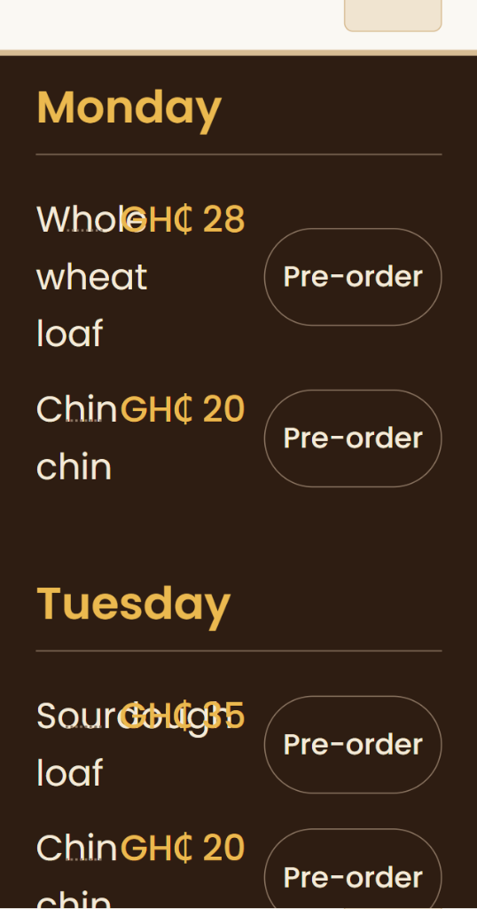 | 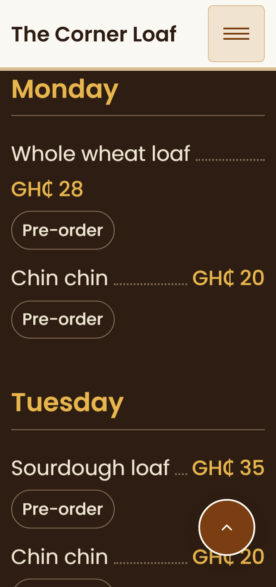 |

### Finding 2: Jumping to a day's menu lands with the heading hidden behind the header

- **Reproduced before fixing:** Yes. Activating the *"View today's menu and pre-order"* link inside `#today-panel` (or an in-page day link) scrolled the page so the target day's `<h3>` heading (`Monday`, `Thursday`, etc.) sat underneath the `position: sticky` header.
- **Cause:** In `ee01/css/styles.css`, `html` had `scroll-padding-top: var(--space-4)` (`1rem`) and `.day` had `scroll-margin-top: var(--space-4)` (`1rem`), whereas the sticky `.site-header` is `48px`–`56px` tall (and taller when text is enlarged). Main `<section>` links only appeared to land cleanly because `section` had `padding-block: var(--space-12)` (`3rem`) of internal top padding, whereas `.day` had `padding: 0`.
- **What I changed:** In `ee01/css/styles.css`, added `--header-offset: 4.75rem` applied to `html { scroll-padding-top: var(--header-offset); }` and `section, .day { scroll-margin-top: var(--header-offset); }`. In `ee01/js/script.js` (`initializeNavigation`), added `syncHeaderOffset()` on load, breakpoint change, and a `requestAnimationFrame`-throttled `resize` handler (`scheduleHeaderOffsetSync`, cancelled on `pagehide`) to set `--header-offset` dynamically from `siteHeader.offsetHeight + 16px` without layout thrashing.
- **Why this fixes the cause, not just the symptom:** Binding the scroll offset to a CSS custom property that defaults to `4.75rem` without JS and dynamically tracks the rendered `.site-header` height ensures every in-page anchor target clears the sticky header across all viewport widths and font-size settings.
- **How I verified it:** Activated `.today-more a` (`#thu`) at `320px` viewport width; verified `.site-header` bottom is at `y = 56px` while `#thu h3` lands at `y = 144.34px` (`+88.34px` clear of the header).

  | Before (flagged in peer audit) | After (fixed at 320px) |
  | :---: | :---: |
  | 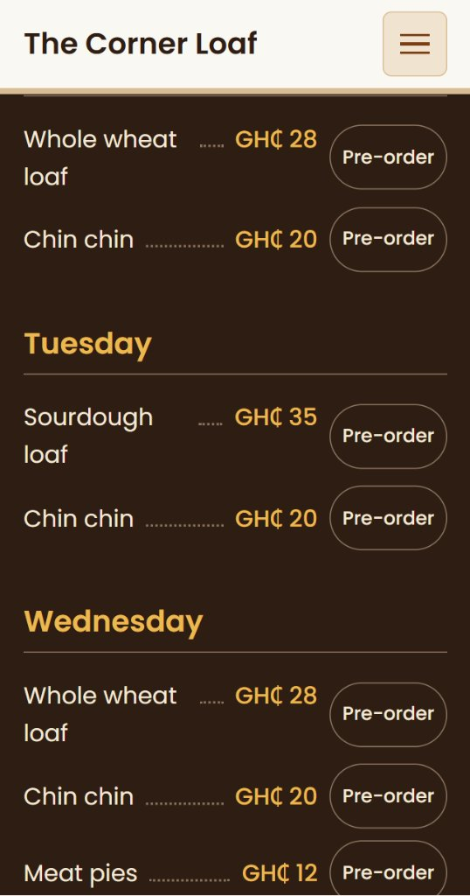 | 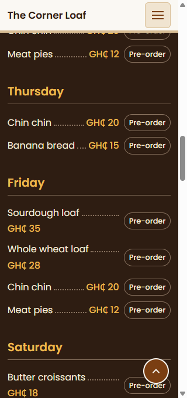 |

### Finding 3: The contact section forces sideways scrolling when text is enlarged

- **Reproduced before fixing:** Yes. At `320px` viewport width with browser font size set to *Very large*, the *Hours and contact* section overflowed horizontally and forced two-dimensional scrolling.
- **Cause:** In `ee01/css/styles.css`, `.contact-grid` previously used `grid-template-columns: repeat(auto-fit, minmax(15rem, 1fr))`. At Chrome's *Very large* font size (`24px` root), `15rem` equals `360px`—wider than the `320px` viewport. In addition, the column containers lacked `min-width: 0` and long unbroken strings like `thecornerloaf@email.com` lacked `overflow-wrap: anywhere`.
- **What I changed:** In `ee01/css/styles.css`, replaced the `minmax(15rem, 1fr)` track with a mobile-first single-column grid (`grid-template-columns: minmax(0, 1fr)` on mobile, stepping up to `repeat(2, minmax(0, 1fr))` at `38rem` and `repeat(3, minmax(0, 1fr))` at `56rem`), added `.contact-col { min-width: 0; }`, and set `overflow-wrap: anywhere` on links (`a`) and `overflow-wrap: break-word` on headings, paragraphs, and `<address>`.
- **Why this fixes the cause, not just the symptom:** Using `minmax(0, 1fr)` guarantees no grid track can ever exceed the viewport width regardless of root `rem` scaling, while `min-width: 0` and `overflow-wrap: anywhere` allow long email addresses and headings to wrap cleanly inside narrow columns.
- **How I verified it:** Verified at `320px` viewport width (both default `16px` and Very large `24px` font sizes) with `overflow-x: clip` temporarily disabled (`overflow-x: visible` on `html` and `body`) so no hidden overflow could be masked: `scrollWidth = 320px === innerWidth` with `0` overflowing elements across `#contact`, `#menu`, `#pre-order`, `#about`, and `.site-footer`.

### Finding 4: The header breaks apart and half of it disappears when text is very large

- **Reproduced before fixing:** Yes. At `320px` width with *Very large* font size, the brand link (*The Corner Loaf*) and the mobile menu button wrapped onto two rows inside the sticky header, making the sticky bar overly tall while scrolling.
- **Cause:** In `ee01/css/styles.css`, `.header-inner` used `flex-wrap: wrap` with `column-gap: var(--space-6)` (`1.5rem`) and `.brand` had a fixed `var(--step-1)` (`1.25rem`) font size. At `320px` with `24px` root font size, the brand text, gap, and `2.75rem` toggle button exceeded the row width and pushed `.menu-toggle` onto a second line.
- **What I changed:** In `ee01/css/styles.css`, set `.header-inner` at mobile widths (`@media (max-width: 44rem)`) to `flex-wrap: nowrap; gap: var(--space-2);`, gave `.brand` a fluid `font-size: clamp(1rem, 0.9rem + 0.8vw, var(--step-1)); min-width: 0; line-height: 1.2;`, and set `flex-shrink: 0` on `.menu-toggle`.
- **Why this fixes the cause, not just the symptom:** Keeping `.header-inner` single-line (`nowrap`) on mobile while letting `.brand` scale fluidly prevents wrapping and keeps the sticky header compact at all font sizes.
- **How I verified it:** Verified at `320px` width that `.brand` and `.menu-toggle` sit cleanly on one row at both default (`16px` root, `y = 4px`, `56px` header) and Very large (`24px` root, `y = 6px`, `82px` header) font sizes.

  | Before (Findings 3 & 4 in peer audit) | After (Findings 3 & 4 fixed at 320px, Very large 24px font) |
  | :---: | :---: |
  | 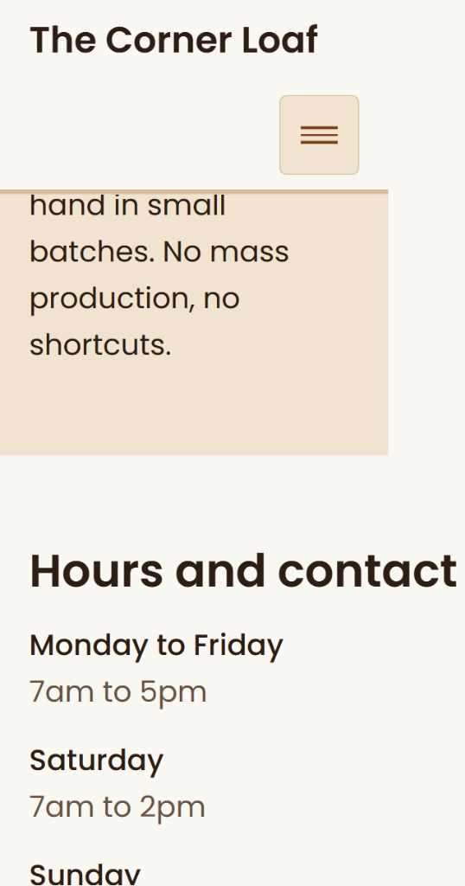 | 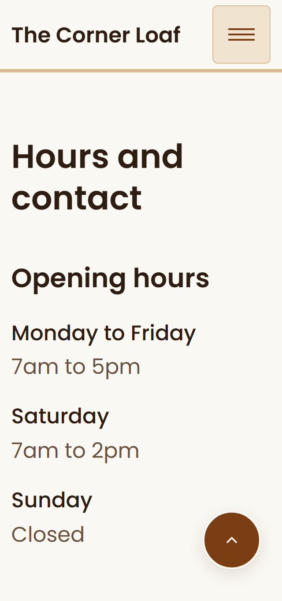 |

### Finding 5: The mobile menu cannot be closed with the Escape key

- **Reproduced before fixing:** Yes. Opening the mobile menu with `Enter` or `Space` and pressing `Escape` left the menu open.
- **Cause:** `initializeNavigation()` in `ee01/js/script.js` only listened for `click` events on `.menu-toggle` and navigation links, with no `keydown` listener for `Escape`.
- **What I changed:** Added a `document.addEventListener('keydown', ...)` handler in `initializeNavigation()` (`ee01/js/script.js`) that checks `event.key === 'Escape'` when the mobile menu is expanded, sets `aria-expanded="false"`, hides `#primary-navigation`, and calls `menuToggle.focus()`.
- **Why this fixes the cause, not just the symptom:** Implementing the WAI-ARIA disclosure keyboard pattern lets keyboard and screen reader users dismiss the open menu from anywhere on the page and immediately returns focus to the trigger button.
- **How I verified it:** At `320px` mobile width, opened `.menu-toggle` (`aria-expanded="true"`), pressed `Escape`, and verified `#primary-navigation` closed (`hidden`), `aria-expanded` reset to `"false"`, and `document.activeElement` returned to `.menu-toggle`.

### Finding 6: Reloading the page throws a person back to the top (not fixed — intentional trade-off)

- **Status:** Intentionally retained; see [Findings I did not fix, or disagree with](#findings-i-did-not-fix-or-disagree-with) below and the in-code rationale above `resetScrollOnRefresh()` in `ee01/js/script.js`.

### Finding 7: The page asks people to pick a day on desktop, where there is nothing to pick

- **Reproduced before fixing:** Yes. On desktop viewports (`> 40rem`), the paragraph under *This week's bakes* read *"Pick your day to see what is on the shelf"*, even though the `Mon`–`Sun` day jump links were hidden on desktop (`display: none`) and all seven days were already displayed in a grid.
- **Cause:** The `.lede` copy assumed users had to click a day link to view that day's items, which did not match the visible page structure where every day's menu is shown directly below.
- **What I changed:** Removed the redundant `.day-jump` list across both desktop and mobile (all seven days stack cleanly right below the heading, while the live `.today-more` link in `#today-panel` still jumps mobile and desktop visitors directly to today's or the next open day's heading `#mon`–`#sat`) and updated the `.lede` paragraph in `ee01/index.html` to read: *"We bake in small batches, and not everything is out every day. Here is what is on the shelf each day of the week."*
- **Why this fixes the cause, not just the symptom:** Aligning the introductory copy with the actual layout removes the confusing instruction to look for a non-existent control while preserving direct jumping to today's day heading from the first screen.
- **How I verified it:** Checked *This week's bakes* across desktop (`1280px`) and mobile (`320px`) viewports and confirmed the copy accurately describes the visible schedule and `.today-more` jumps directly to the current day's heading.

  | Before (flagged in peer audit) | After (fixed on desktop) |
  | :---: | :---: |
  | 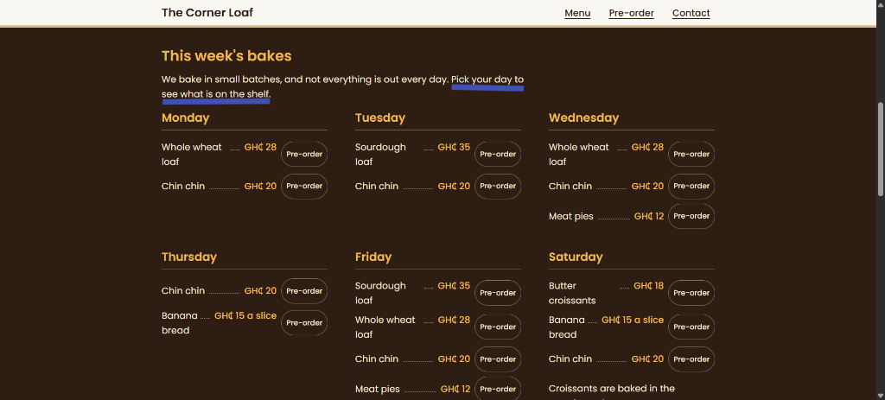 | 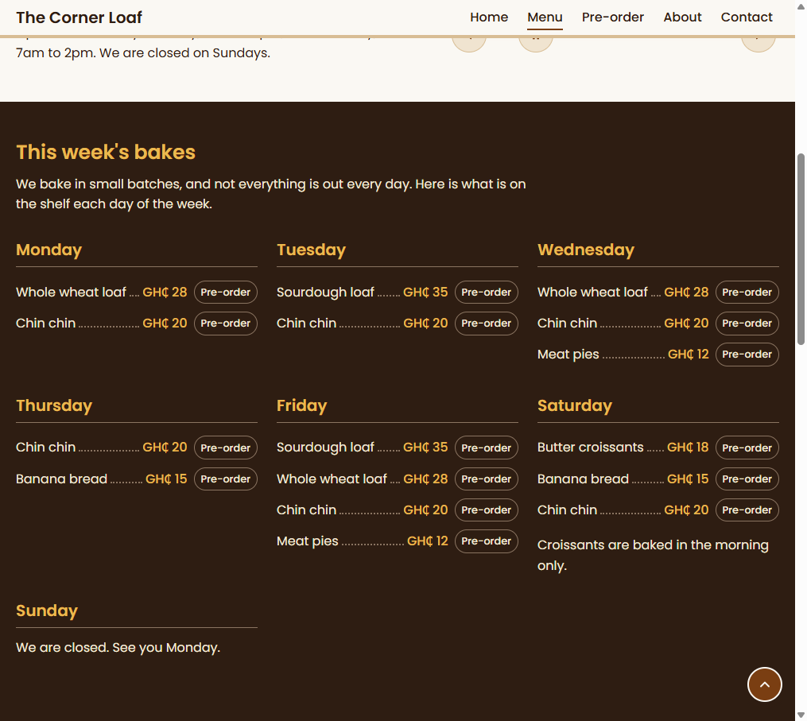 |

### Finding 8: Prices are read out as letters: "G H Ghanaian cedi"

- **Reproduced before fixing:** Yes. In NVDA (as reported in Joshua's peer audit), `GH₵ 35` was announced as `"G H Ghanaian cedi 35"`, while in Windows Narrator the `₵` symbol was skipped entirely (`"GH 35"`).
- **Cause:** Screen reader speech synthesizers handle the `GH₵` prefix and Unicode Cedi sign (`U+20B5`) inconsistently when read directly from raw text nodes.
- **What I changed:** In `ee01/index.html` and `ee01/css/styles.css`, added a `.sr-only` utility class and wrapped every price across the bake showcase and weekly menu as `GH₵ 3535 Ghana cedis` (and `15 Ghana cedis a slice` for banana bread). Neither `.price` nor its parent `<li>` carries an `aria-label`, so hiding the visual `GH₵` span with `aria-hidden="true"` exposes only the single `.sr-only` text node with no risk of double-announcement. In the `#preorder-item` `<select>` dropdown (where `<option>` cannot contain `aria-hidden` spans), wrote prices directly as `"35 Ghana cedis"`, `"28 Ghana cedis"`, etc.
- **Why this fixes the cause, not just the symptom:** Replacing the visual currency symbol with plain English words in the accessibility tree removes synthesizer ambiguity so screen readers announce `"35 Ghana cedis"` cleanly rather than spelling out `"G H"` or dropping `₵`.
- **How I verified it:** Exercised directly with **Windows Narrator** on Chrome/Edge (alongside Chrome's accessibility tree inspector) and confirmed every price announces once as `"35 Ghana cedis"`, `"28 Ghana cedis"`, etc. *(NVDA was exercised in Joshua's peer audit; VoiceOver and TalkBack were not directly tested on physical devices, though the plain `.sr-only` text pattern is designed to read identically across screen readers.)*

---

## Additional accessibility & hygiene improvements I found myself

1. **Safari / VoiceOver list semantics preserved (`role="list"`):** In `ee01/css/styles.css`, `.nav-list` and `.menu-list` use `list-style: none`. Because WebKit/Safari removes the implicit `list` role from `<ul>` elements styled with `list-style: none` (noted as an untested risk in Joshua's audit), I added explicit `role="list"` attributes to all styled `<ul>` elements in `ee01/index.html`.
2. **Skip link target focus (`tabindex="-1"` on `<main>`):** Added `tabindex="-1"` to `<main id="main">` so activating the restored *"Skip to content"* link reliably moves programmatic focus to `#main` across browsers and screen readers.
3. **Button boundaries in Windows High Contrast (Forced Colors) mode:** `.btn` previously relied only on `background: var(--crust)` with no border. I added `border: 1px solid transparent;` to `.btn` in `ee01/css/styles.css` so Windows High Contrast themes automatically render a crisp visible button border.
4. **Complete main navigation links (`Home` and `About`):** Restored `Home` (`#top`) and `About` (`#about`) in the header navigation alongside `Menu`, `Pre-order`, and `Contact` so keyboard and screen reader users can reach every major section from the main landmark.
5. **Scroll-to-top focus recovery & JSDoc type contracts:** When `#scroll-top-btn` is activated and hides itself at the top of the page, focus moves to `.brand` (`preventScroll: true`) so keyboard users never lose focus to `<body>`. Added `@ts-check` and JSDoc `@typedef` / `@param` / `@returns` annotations throughout `ee01/js/script.js` so data shapes and function contracts are explicit.

---

## Findings I did not fix, or disagree with

- **Finding 6 (Reloading the page throws a person back to the top):** I intentionally kept `resetScrollOnRefresh()` in `ee01/js/script.js` (which Joshua marked as a non-WCAG recommendation and noted appeared deliberate). The primary purpose of The Corner Loaf's first screen is to give walk-by customers an immediate, live answer to *"Are you open right now, and what is on the shelf today?"* When a customer refreshes the page at a later hour, returning to the top ensures they immediately see the updated live open/closed status banner (`#today-panel`) rather than remaining scrolled down in a static footer or old section. Standard in-page navigation links (`#menu`, `#pre-order`, `#about`, `#contact`, `#mon`–`#sun`) still work normally during the session.

---

## Further improvement

- **What I built:**
  1. **Accessible on-site Pre-order form & Contact form (`#preorder-form` and `#contact-form`):** Restored both forms alongside the WhatsApp links. Ordered the Pre-order form logically as **Bakery item**, **Quantity**, **Collection date**, **Your name**, and **Phone number**, where **Collection date** dynamically lists open collection dates starting from **tomorrow (at least one day's notice)** up to 7 days ahead—automatically skipping closed Sundays **and filtering to only the days the selected bake is actually made** (e.g., Tuesdays and Fridays for Sourdough loaf). Both forms include `autocomplete` attributes (`name`, `tel`, `email`), explicit `(required)` labels, and `role="status" aria-live="polite"` confirmations. On validation failure, the script marks the first invalid field with `aria-invalid="true"` + `aria-describedby` linked to the live status message and moves focus directly to it; because each form has only 3–5 fields on a single screen, moving focus straight to the first error avoids the overhead of a separate multi-error summary banner while guiding keyboard and screen reader users step-by-step.
  2. **Accessible Single-Box Bake Showcase Carousel (`<aside class="bake-gallery" id="bake-carousel">`):** Added a compact single-box slideshow of real bakery photographs beside the *Today's bakes* panel on desktop (and centered cleanly below on tablet and mobile viewports). Each slide uses `role="group" aria-roledescription="slide" aria-label="1 of 6"` stacked in a single CSS Grid cell (`grid-area: 1 / 1`) so every slide reserves the height of the tallest card with zero vertical layout shift; inactive slides use a dedicated `.is-inactive` class paired with `aria-hidden="true"` and `inert` (rather than overriding native `[hidden]`), keeping them completely out of the accessibility tree and keyboard Tab order. Controls include **Previous**, **Pause/Play** (meeting WCAG 2.2.2 Level A for both touch and keyboard users), and **Next** buttons (`44×44px` touch targets), plus six slide-picker dot buttons with `24×24px` hit targets (meeting WCAG 2.5.8). Auto-rotation also pauses on mouse hover, keyboard focus, tab visibility loss, `pagehide`, or `prefers-reduced-motion: reduce`. All six images are lightweight `480×360` WebP files (`30–56 KB` each) with explicit `width`/`height` attributes and `aspect-ratio: 4 / 3` (`CLS = 0`). A single `480px` width is served intentionally without `srcset`/`sizes` because the carousel card caps at `26rem` (`416px` CSS width), meaning `480px` provides crisp `1.15×–1.5×` density on `320px–416px` viewports while staying under `56 KB` per image.
- **Who it helps:**
  1. Customers who **do not use WhatsApp** (or are ordering from a desktop computer without WhatsApp installed, or who have motor impairments, dyslexia, or memory difficulties and benefit from structured forms with browser `autocomplete` and local repeat-visit autofill).
  2. Visual shoppers and customers with cognitive or reading differences who want to **see what each bake looks like** alongside today's opening status before deciding what to buy.
- **The barrier they faced:**
  1. In my EE01 rebuild, replacing the broken original pre-order and contact forms entirely with WhatsApp links meant that anyone without WhatsApp had no way to place a pre-order or send a message directly on the website.
  2. The rebuilt page had no photos of the six signature bakes, forcing customers to decide from text names alone.
- **Why it is worth doing for the business:** Marcus keeps the speed of one-tap WhatsApp pre-orders for mobile regulars while capturing orders and inquiries from customers who do not use WhatsApp. Filtering collection dates by each item's baking schedule and enforcing the one-day minimum lead time prevents invalid orders before they ever reach Marcus, and the compact carousel showcases all six signature bakes without pushing the weekly menu down the page.
- **How I verified it:**
  - Verified desktop (`1280×900`) and narrow mobile (`320×700`) layouts with `0` console errors and `0` horizontal overflow.
  - Verified carousel controls (`#carousel-prev`, `#carousel-toggle`, `#carousel-next` all `44×44px`; all 6 `.carousel-dot` buttons `24×24px`), Pause/Play `aria-pressed` / `aria-label` toggling, slide transitions, `prefers-reduced-motion` handling, and Chrome's full accessibility tree (`Accessibility.getFullAXTree`) confirming `0` inactive slides are exposed.
  - Verified keyboard-only validation and submission on both `#preorder-form` and `#contact-form`: confirmed `aria-invalid="true"`, `aria-describedby`, live `role="status"` announcements, automatic focus movement to invalid fields, schedule-filtered collection dates for *Sourdough loaf*, and live `#preorder-results` output.

  | Before (EE01 desktop hero without photos) | After (EE02 hero with accessible bake carousel) |
  | :---: | :---: |
  | 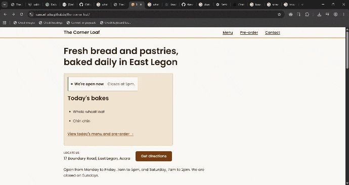 | 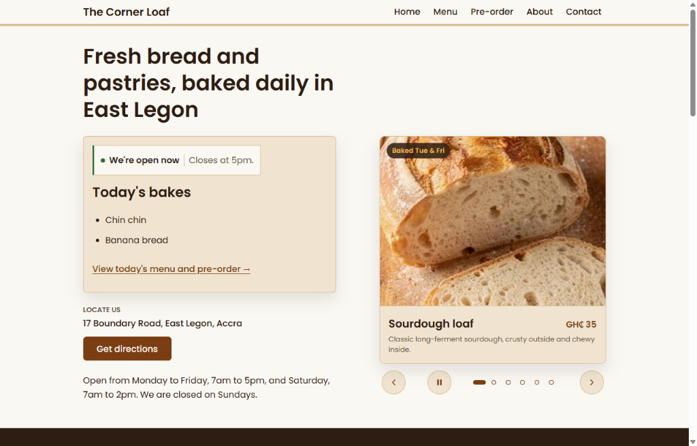 |

  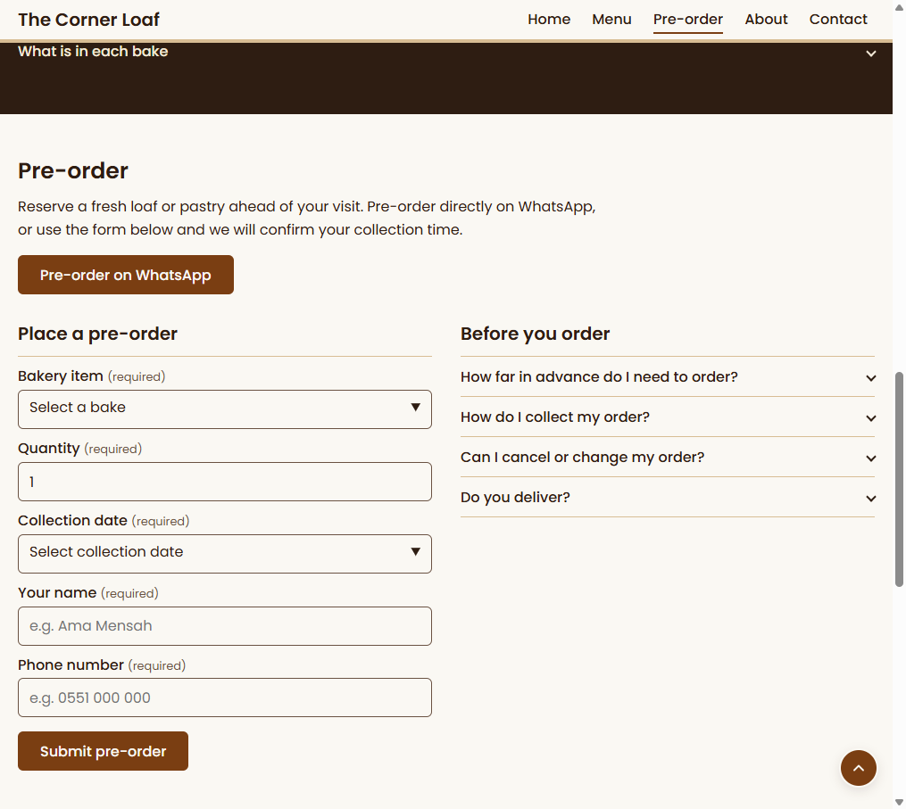
